# 🎨 SVGs Animados - AgroVision AI

## 📁 Arquivos na Pasta

A pasta `web/svg/` contém **3 SVGs animados com CSS** demonstrando a usabilidade da ferramenta em tempo real:

---

## 📊 1. `dashboard-tempo-real.svg`

**Dimensões:** 1200x800px

**Demonstra:**
- Cena de fazenda com 3 animais (vaca, bezerro, touro)
- Bounding boxes com animação de dash (tracejado em movimento)
- Scanning line vertical descendo continuamente
- Labels flutuantes com IDs e pesos
- Estatísticas em cards animados
- Gráfico de barras por hora
- Indicador "Tempo Real" pulsando

**Animações CSS:**
- `animalWalk` - Animais caminhando (4s loop)
- `scanMove` - Linha de scanning vertical (3s loop)
- `bboxDash` - Bounding boxes tracejadas (1s loop)
- `pulse` - Indicador de status (2s loop)
- `barGrow` - Barras do gráfico crescendo
- `counterPulse` - Números pulsando



---

## 🔍 2. `deteccao-tempo-real.svg`

**Dimensões:** 1600x900px

**Demonstra:**
- Detecção em tempo real com 3 animais detectados
- Bounding boxes com cores por status:
  - 🟢 Verde: Detecção confirmada (#001 - Calmo)
  - 🔵 Azul: Nova detecção (#002 - Novo)
  - 🟠 Laranja: Alerta (#003 - Agitado)
- Labels com informações de confiança
- Tabela de tracking data
- Gráfico de barras de confiança
- Informações do tracker (DeepSort)

**Animações CSS:**
- `bboxDashMove` - Dash das bounding boxes (2s loop)
- `newDetectionPulse` - Pulsção para novas detecções (1.5s loop)
- `scanVertical` - Scanning descendente (4s loop)
- `labelFloat` - Labels flutuando (3s labelFloat)
- `confidenceGrow` - Barras de confiança crescendo
- `rowFlash` - Linhas da tabela highlight (3s loop)



---

## 📈 3. `estatisticas-animadas.svg`

**Dimensões:** 1400x900px

**Demonstra:**
- 5 cards de métricas:
  - Total de animais (24)
  - Peso médio (156 kg)
  - Precisão (94%)
  - Tempo de sessão (02:47)
  - Alertas (3 hoje)
- Gráfico de atividade por hora (área + linha)
- Gráfico de comportamento (barras)
- Gráfico de rosca (distribuição por peso)
- Timeline de eventos recentes

**Animações CSS:**
- `counterTick` - Números pulsando (2s loop)
- `lineDraw` - Linha do gráfico desenhando (3s)
- `barExpand` - Barras expandindo (1.2s delay por barra)
- `pieFill` - Rosca preenchendo (2s)
- `float` - Cards flutuando (4s loop)
- `shimmer` - Timer brilhando (2s loop)
- `pulseRing` - Alertas pulsando


---

## 🌐 4. `index.html` - Visualizador de SVGs

**Visualizador alternativo** para navegar entre os SVGs.

**Características:**
- Tabs de navegação
- Auto-rotatção a cada 10 segundos
- Animações CSS inline embutidas
- Design responsivo

**Como usar:**
```bash
# (no diretório web/)
python -m http.server 8080

# Acesse: http://localhost:8080/svg/index.html
```

---

## 🎯 Como Visualizar os SVGs

### Opção 1: Abrir Diretamente
```bash
# Clique duplo no arquivo .svg ou abra no navegador
start C:\Users\Thinkin pad 8g\AgroVision-AI\web\svg\dashboard-tempo-real.svg
```

### Opção 2: Via Visualizador HTML
```bash
cd C:\Users\Thinkin pad 8g\AgroVision-AI\web\svg
python -m http.server 8080

# Acesse no navegador: http://localhost:8080
```

### Opção 3: Integrar no Dashboard
Os SVGs também podem ser incorporados no dashboard principal:
```html
<iframe src="svg/dashboard-tempo-real.svg" width="100%" height="600"></iframe>
```

---

## 📋 Resumo das Animações CSS

| Animação | Duração | Elemento | Descrição |
|----------|---------|----------|-----------|
| `animalWalk` | 4s | Animais | Caminhada esquerda-direita |
| `scanMove` | 3s | Scan line | Varredura top-bottom |
| `bboxDash` | 1s | Bounding boxes | Tracejado em movimento |
| `newDetectionPulse` | 1.5s | Nova detecção | Pulsção azul |
| `pulse` | 2s | Status dot | Indicador ao vivo |
| `barGrow` | 1s | Gráfico barras | Crescimento vertical |
| `lineDraw` | 3s | Gráfico linha | Desenho da linha |
| `pieFill` | 2s | Rosca | Preenchimento circular |
| `float` | 4s | Cards | Flutuação vertical |
| `counterPulse` | 2s | Números | Pulsão numérica |

---

## 🎨 Cores Utilizadas

| Cor | Hex | Uso |
|-----|-----|-----|
| Verde | `#10b981` | Detecções normais, sucesso |
| Verde claro | `#34d399` | Confirmações |
| Azul | `#3b82f6` | Novas detecções |
| Azul claro | `#60a5fa` | Informações |
| Laranja | `#f59e0b` | Alertas, avisos |
| Amarelo | `#fbbf24` | Ênfase |
| Vermelho | `#ef4444` | Erros, alertas críticos |
| Roxo | `#8b5cf6` | Tempo, sessões |

---

## 🔧 Tecnologias

- **SVG 1.1** - Scalable Vector Graphics
- **CSS3 Animations** - Keyframes e transições
- **Gradientes SVG** - LinearGradient, radial
- **Filtros SVG** - GaussianBlur para glow
- **Clips e Masks** - Recortes de área
- **Embeds Inline** - Styles dentro do SVG

---

## ✅ Arquivos Criados

```
web/svg/
├── dashboard-tempo-real.svg   ✅ 16 KB
├── deteccao-tempo-real.svg    ✅ 22 KB
├── estatisticas-animadas.svg  ✅ 24 KB
└── index.html                 ✅ 8 KB
```

**Total:** 4 arquivos, ~70 KB combinados

---

## 🚀 Próximos Passos

1. **Testar no navegador** - Abrir qualquer SVG para ver animações
2. **Integrar no dashboard** - Usar como background ou iframe
3. **Customizar** - Ajustar cores/velocidades conforme necessidade
4. **Exportar** - Usar como reference para produção

---

*SVGs gerados em 2024-07-04*
*AgroVision AI v2.0*

---

## 📁 Estrutura da Pasta

```
web/svg/
├── README.md                      # Esta documentação
├── index.html                     # Visualizador com tabs
├── dashboard-tempo-real.svg       # Dashboard completo (16 KB)
├── deteccao-tempo-real.svg        # Detecção e tracking (22 KB)
└── estatisticas-animadas.svg      # Métricas e gráficos (24 KB)
```

**Total:** 5 arquivos, ~70 KB combinados